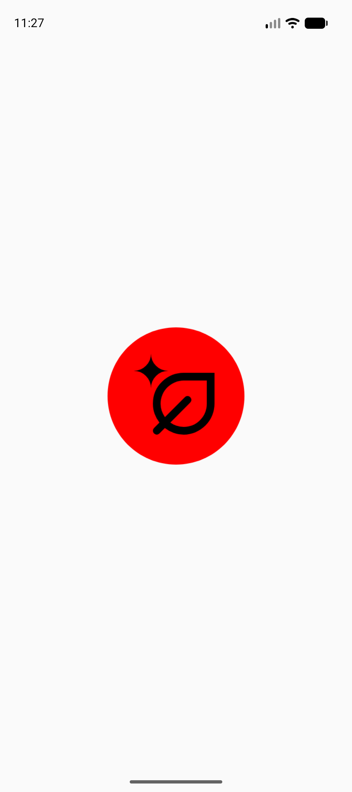
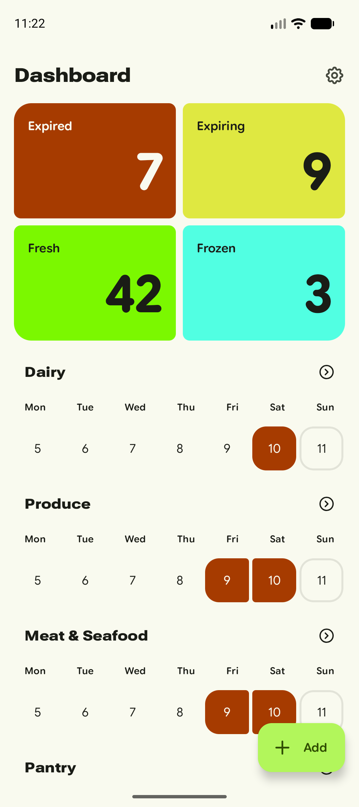
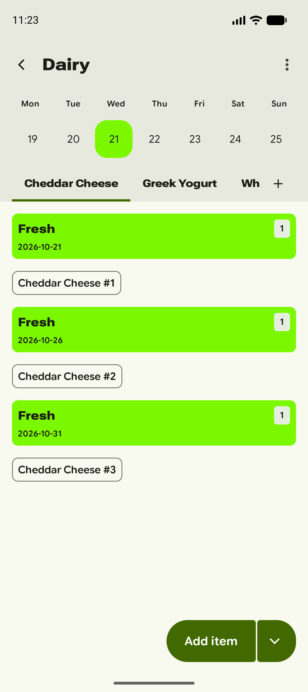
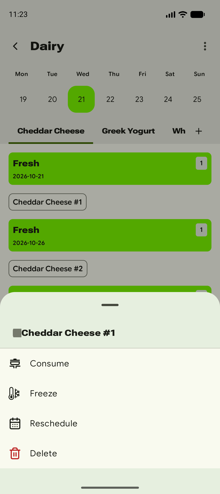
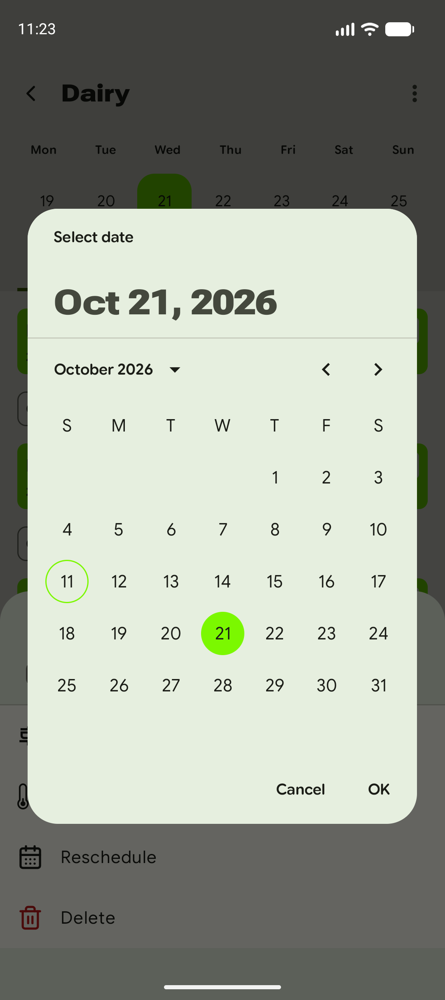
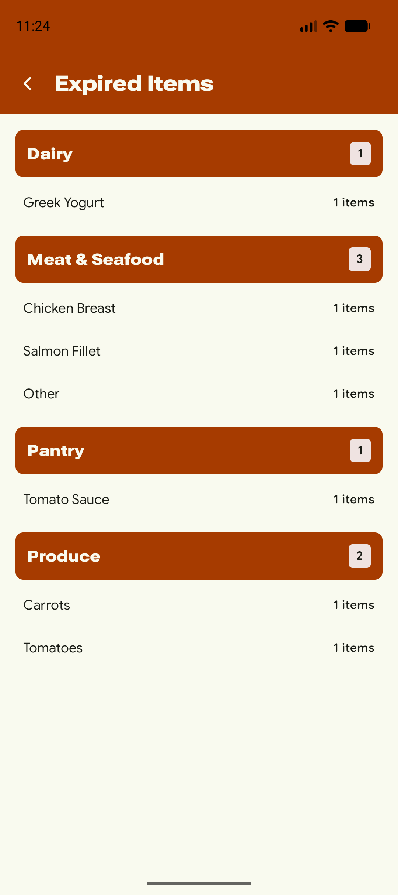
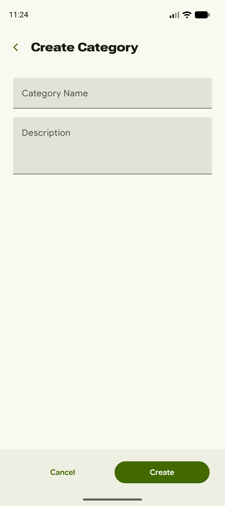
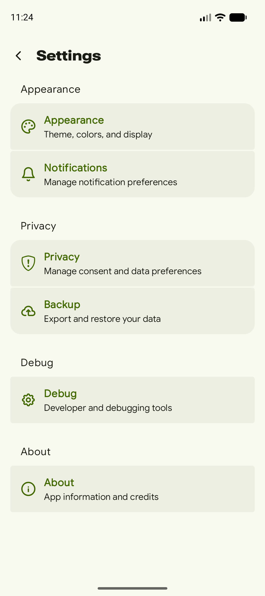
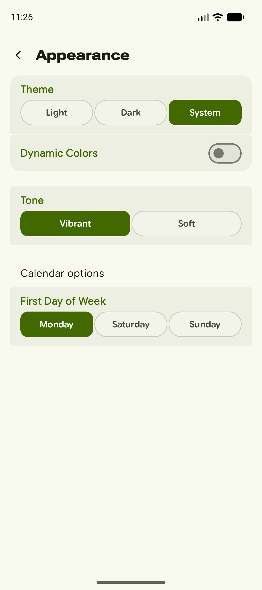

# Caducity — captures dels fluxos principals

Build `debug` (`com.alorma.caducity.dev`) sobre l'emulador Pixel 9, amb dades de demostració.

| # | Captura | Què representa |
|---|---------|----------------|
| 00 |  | **Splash screen.** Pantalla d'arrencada en fred, amb la icona de l'app (full amb una espurna, en negre sobre un cercle vermell). |
| 01 |  | **Dashboard.** Pantalla principal: targetes resum per estat (Expired, Expiring, Fresh, Frozen) i, sota, un calendari setmanal per categoria (Dairy, Produce, Meat & Seafood, Pantry…). El botó **Add** permet crear una categoria i la roda de configuració porta a Settings. |
| 02 |  | **Detall de categoria (Dairy).** Calendari de la setmana, pestanyes per producte (Cheddar Cheese, Greek Yogurt, Whole Milk…) i els ítems agrupats per data de caducitat, amb el seu estat. Botó **Add item** a baix. |
| 03 |  | **Accions d'un ítem.** Bottom sheet que s'obre en tocar un ítem: Consume, Freeze, Reschedule i Delete. |
| 04 |  | **Reschedule.** Selector de data per canviar la caducitat de l'ítem (Cancel / OK). Es va cancel·lar, no s'ha canviat cap dada. |
| 05 |  | **Ítems filtrats per estat.** Es mostra en tocar una targeta del dashboard (aquí, *Expired Items*): llista agrupada per categoria amb els productes i el nombre d'ítems. |
| 06 |  | **Crear categoria.** Formulari amb nom i descripció, i botons Cancel / Create. |
| 07 |  | **Settings.** Seccions Appearance, Notifications, Privacy, Backup, Debug i About. |
| 08 |  | **Settings › Appearance.** Tema (Light / Dark / System), Dynamic Colors, to (Vibrant / Soft) i primer dia de la setmana. |

## Flux resumit

`Splash → Dashboard → (targeta d'estat → Ítems filtrats) | (categoria → Detall → ítem → Accions → Reschedule) | Add → Crear categoria | Settings → Appearance`
