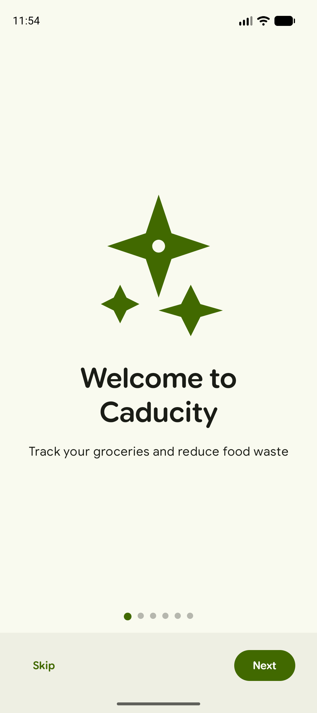
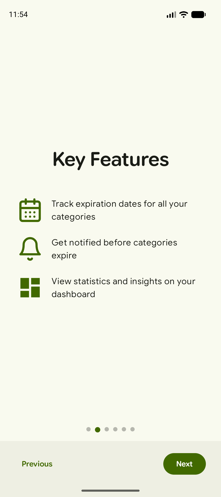
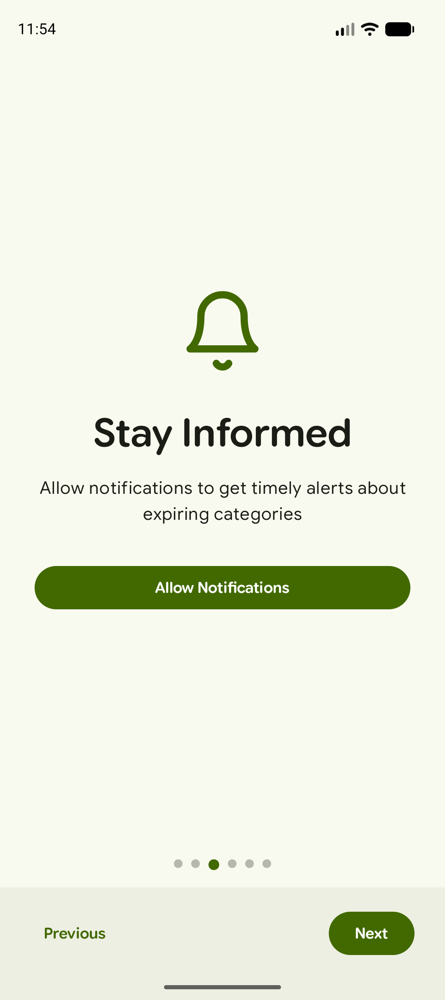
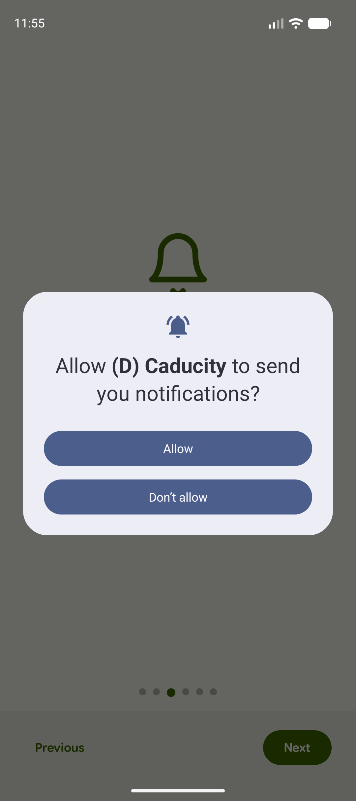
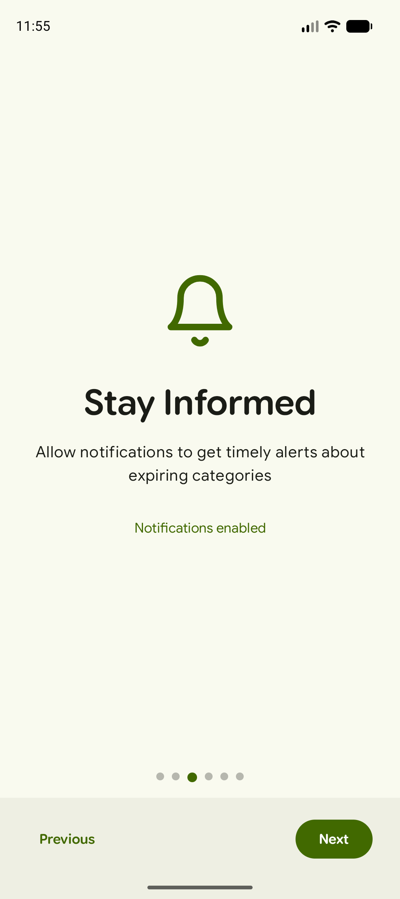
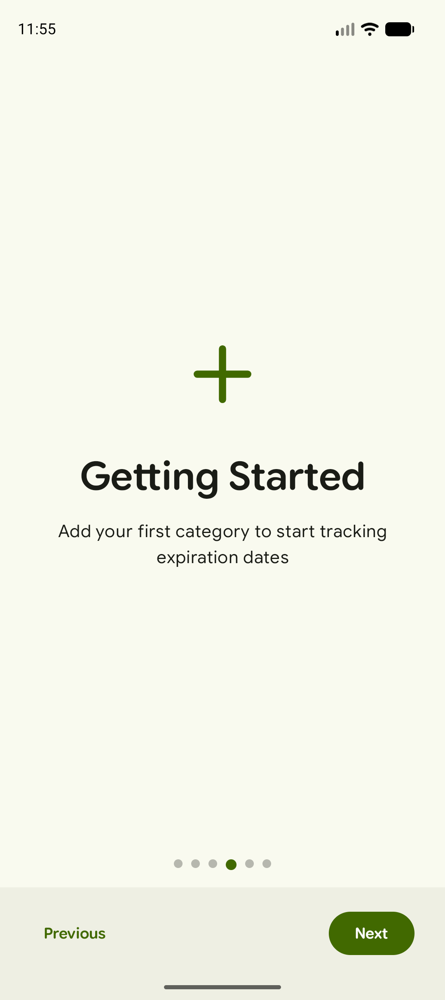
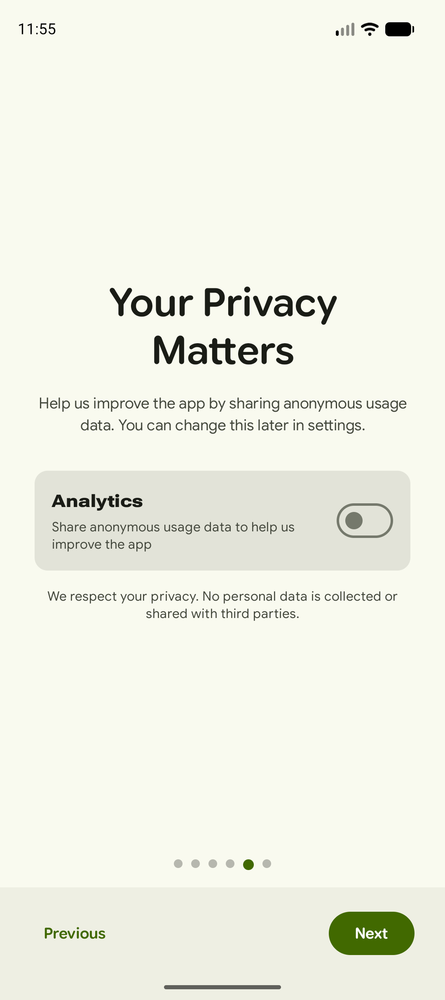
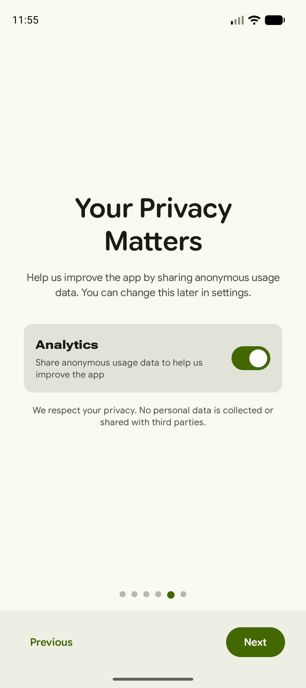
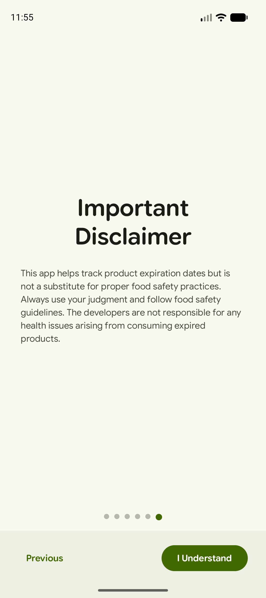
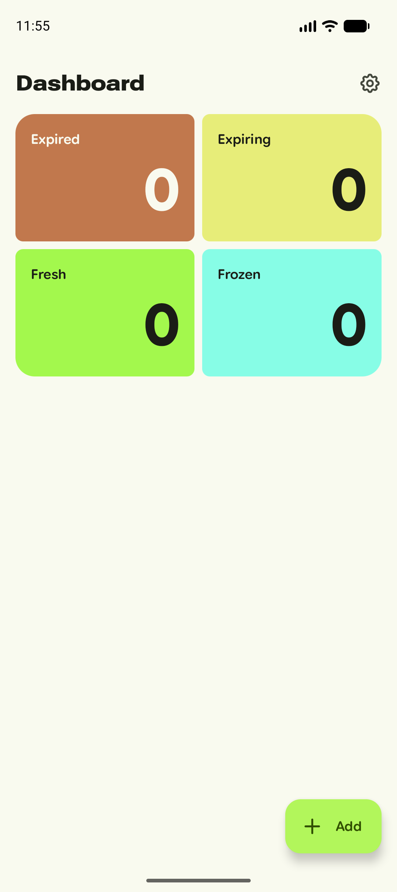

# Caducity — Onboarding

Primer arrencament de l'app (build `debug`, emulador Pixel 9, dades netes). L'onboarding té **6 pàgines** (els punts de la part inferior marquen la pàgina actual) amb navegació **Previous / Next**; a la primera hi ha **Skip** i a l'última el botó **I Understand**.

| # | Captura | Què representa |
|---|---------|----------------|
| 01 |  | **Pàgina 1 — Benvinguda.** «Welcome to Caducity — Track your groceries and reduce food waste». Botons **Skip** (salta l'onboarding) i **Next**. |
| 02 |  | **Pàgina 2 — Key Features.** Tres funcions: seguiment de dates de caducitat per categoria, avisos abans que caduquin i estadístiques al dashboard. |
| 03 |  | **Pàgina 3 — Stay Informed.** Explica les notificacions d'avís de caducitat, amb el botó **Allow Notifications**. |
| 04 |  | **Submenú de la pàgina 3.** Diàleg de permís de notificacions del sistema Android (*Allow* / *Don't allow*), que apareix en tocar el botó anterior. |
| 05 |  | **Pàgina 3 després de permetre.** El botó desapareix i es mostra el text «Notifications enabled». |
| 06 |  | **Pàgina 4 — Getting Started.** Invita a afegir la primera categoria per començar a seguir caducitats. |
| 07 |  | **Pàgina 5 — Your Privacy Matters (consentiment).** Interruptor d'**Analytics** per compartir dades d'ús anònimes. Per defecte està **desactivat** (enfocament *privacy-first*) i es pot canviar després a Settings. |
| 08 |  | **Pàgina 5 amb Analytics activat.** Mateixa pantalla amb l'interruptor en ON. Després el vaig tornar a deixar desactivat. |
| 09 |  | **Pàgina 6 — Important Disclaimer.** Avís legal: l'app no substitueix les bones pràctiques de seguretat alimentària. El botó **I Understand** finalitza l'onboarding. |
| 10 |  | **Resultat: Dashboard buit.** Pantalla principal després de l'onboarding, amb tots els comptadors a 0 i el botó **Add** per crear la primera categoria. |

## Flux resumit

`Welcome → Key Features → Notificacions (diàleg de permís) → Getting Started → Privacitat/Analytics → Disclaimer → Dashboard`
